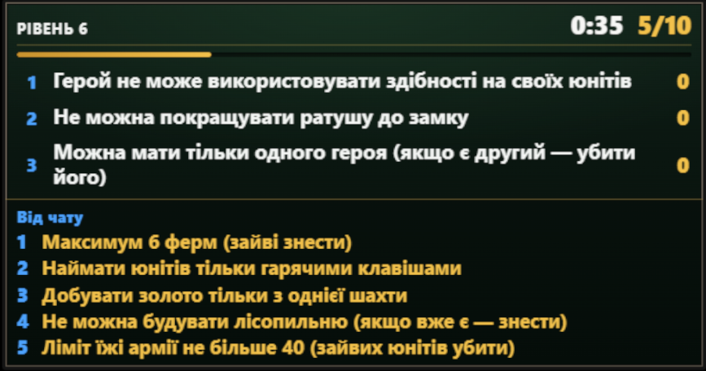

# Віджет для стріму

Я зробив цей віджет для Warcraft III. Це челендж з використанням чату: чат голосує, яке завдання тобі робити.

## OBS

Додай джерело «Браузер».

- Адреса: https://challenge-for-foggy.duckdns.org/overlay
- Ширина: 620
- Висота: 540

Якщо джерело порожнє, натисни на ньому правою кнопкою і вибери «Оновити».

## Як грати

Грати тільки за Альянс.

Є 10 рівнів. Кожні 2 хвилини чат голосує `1`, `2` або `3` за один рівень. З рівня випадають 3 випадкові завдання, чат обирає одне. Воно лишається до кінця матчу і висить знизу в списку «Від чату». Наступний рівень додає нове, старі не зникають. З кожним рівнем завдання стають складнішими.

Перші 2 хвилини списку ще немає. Перший дебаф з’явиться після першого голосування.

Один глядач — один голос. Нова цифра замінює стару. Голоси тільки в чаті Twitch, точно `1`, `2` або `3`.

Усі завдання зі списку «Від чату» працюють разом усю гру, до самої перемоги. Нове не замінює старі: їх треба виконувати усі одразу. Решту часу граєш як хочеш.

Щоб пройти челендж, треба закрити всі **10/10** і перемогти ворога. Після 10/10 нові голосування не з’являються, а вибрані завдання треба тримати до перемоги.

## Команди

Коли матч почався, напиши у свій чат Twitch:

- `cstart` — запустити або перезапустити з нуля
- `coff` — вимкнути завдання
